# Serverless Data Pipeline: API → Lambda → DynamoDB → Scheduled S3 Backups


An end-to-end **serverless data pipeline on AWS** that I built and deployed using the AWS Management Console and Python.

It fetches user data from a public REST API and stores it in **DynamoDB**. Then, every **2 minutes**, it automatically exports the table to a **timestamped JSON backup in a private S3 bucket**. Everything runs on managed services: no servers, no hardcoded credentials, and least-privilege IAM throughout.

---

## Table of Contents

- [Architecture](#architecture)
- [Tech Stack](#tech-stack)
- [Project Structure](#project-structure)
- [How It Works](#how-it-works)
- [IAM & Security Design](#iam--security-design)
- [Deployment Guide](#deployment-guide)
- [Screenshots: Build Walkthrough](#screenshots-build-walkthrough)
- [Key Concepts & Lessons Learned](#key-concepts--lessons-learned)
- [Troubleshooting](#troubleshooting)
- [Production Considerations](#production-considerations)
- [Cleanup](#cleanup)
- [References](#references)

---

## Architecture

```text
                 https://jsonplaceholder.typicode.com/users
                                  |
                                  | HTTP GET (10 sample users)
                                  v
                 [Lambda #1: import-jsonplaceholder-users]
                                  |
                                  | boto3: dynamodb:PutItem
                                  v
                    [DynamoDB: jsonplaceholder-users]
                                  |
                                  | boto3: dynamodb:Scan (paginated)
                                  v
                   [Lambda #2: export-dynamodb-to-s3] <--- [EventBridge Scheduler]
                                  |                           rate(2 minutes)
                                  | boto3: s3:PutObject
                                  v
                       [Private Amazon S3 Bucket]
                       backups/YYYY-MM-DD/users-...json

           BOTH Lambda functions ---> CloudWatch Logs / Metrics
```

| Component | Resource name | Role in pipeline |
| --- | --- | --- |
| Lambda #1 | `import-jsonplaceholder-users` | Fetches users from the API and writes them to DynamoDB |
| DynamoDB table | `jsonplaceholder-users` | NoSQL store, partition key `id` (Number), on-demand capacity |
| Lambda #2 | `export-dynamodb-to-s3` | Scans the table and writes a JSON snapshot to S3 |
| S3 bucket | `lambda-backups-saf` | Private, encrypted (SSE-S3) destination for backups |
| EventBridge Scheduler | `dynamodb-backup-every-2min` | Invokes Lambda #2 at `rate(2 minutes)` |
| CloudWatch | `/aws/lambda/*` log groups | Logs and metrics for both functions |

**Region:** `ca-central-1` (Canada Central). All resources are in the same Region.

---

## Tech Stack

- **AWS Lambda** (Python 3.12, 128 MB, 30 s timeout)
- **Amazon DynamoDB** (on-demand)
- **Amazon S3** (Block Public Access on, SSE-S3 encryption)
- **Amazon EventBridge Scheduler**
- **AWS IAM** (execution roles + inline least-privilege policies)
- **Amazon CloudWatch** (Logs & Metrics)
- **Python:** `boto3`, `urllib` (standard library only, no external dependencies)

---

## Project Structure

```text
s3-lambda-dynamodb-s3backup/
├── README.md
├── lambda_src/
│   ├── import_users/lambda_function.py     # Lambda #1 source: API -> DynamoDB
│   └── backup_users/lambda_function.py     # Lambda #2 source: DynamoDB -> S3
├── lambda_zips/
│   ├── lambda-import-users.zip             # Deployable package for Lambda #1
│   └── lambda-backup-to-s3.zip             # Deployable package for Lambda #2
├── iam_policies/
│   ├── lambda-import-putitem-policy.json   # dynamodb:PutItem on the table only
│   └── lambda-backup-export-policy.json    # dynamodb:Scan + s3:PutObject on backups/*
└── Screenshots/                            # Step-by-step proof of the deployment
```

Both ZIPs contain `lambda_function.py` at the root. The handler for both functions is `lambda_function.lambda_handler`.

---

## How It Works

### Lambda #1: Import users ([source](lambda_src/import_users/lambda_function.py))

1. Sends an HTTP GET to `https://jsonplaceholder.typicode.com/users` using `urllib.request`.
2. Validates that the response is a list and that every record has an integer `id`.
3. Writes each user (including nested `address` and `company` objects) to DynamoDB with `table.put_item()`.
4. Logs each saved user and returns `{"table": ..., "saved_count": 10}`.
5. Re-raises any exception so a failure shows up in Lambda's **Errors** metric.

**Environment variables:** `TABLE_NAME=jsonplaceholder-users`

### Lambda #2: Export to S3 ([source](lambda_src/backup_users/lambda_function.py))

1. Scans the whole DynamoDB table, following `LastEvaluatedKey` so pagination is handled.
2. Sorts the items by `id`.
3. Converts DynamoDB `Decimal` values into JSON-safe `int`/`str` with a custom serializer.
4. Uploads a pretty-printed JSON array to S3 under a **unique, timestamped key**:

   ```text
   s3://lambda-backups-saf/backups/2026-10-27/users-04-16-16-554878-<request-id>.json
   ```

   The key combines the UTC date, the time down to microseconds, and the Lambda request ID. That way every run creates a new file and never overwrites an earlier backup.
5. Returns `{"exported_count": 10, "s3_uri": "...", "scan_pages": 1}`.

**Environment variables:**

| Variable | Value |
| --- | --- |
| `TABLE_NAME` | `jsonplaceholder-users` |
| `BUCKET_NAME` | `lambda-backups-saf` |
| `BACKUP_PREFIX` | `backups` |

### Automation

An **EventBridge Scheduler** schedule (`rate(2 minutes)`, flexible time window off) invokes Lambda #2. The scheduler has its **own** execution role that only allows it to invoke the function.

---

## IAM & Security Design

Each function has its own execution role. Each role gets only the permissions that function needs:

| Role | Policies | Allowed actions |
| --- | --- | --- |
| Lambda #1 execution role | `AWSLambdaBasicExecutionRole` + [`lambda-import-putitem-policy`](iam_policies/lambda-import-putitem-policy.json) | Write CloudWatch logs, `dynamodb:PutItem` on `jsonplaceholder-users` only |
| Lambda #2 execution role | `AWSLambdaBasicExecutionRole` + [`lambda-backup-export-policy`](iam_policies/lambda-backup-export-policy.json) | Write CloudWatch logs, `dynamodb:Scan` on the table, `s3:PutObject` on `backups/*` |
| Scheduler execution role | Auto-created by EventBridge Scheduler | `lambda:InvokeFunction` on `export-dynamodb-to-s3` |

Security practices I followed:

- **No hardcoded credentials.** Boto3 picks up temporary credentials from the execution role.
- **Least privilege.** Neither function can delete data, and the import function cannot read S3.
- **Private bucket.** S3 Block Public Access is enabled, with default SSE-S3 encryption.
- **No VPC attachment.** Lambda #1 can reach the public API without needing a NAT gateway.

> The policy files in `iam_policies/` use `REGION`, `ACCOUNT_ID`, and `YOUR_UNIQUE_BUCKET_NAME` as placeholders. Replace them with your own values before you deploy.

---

## Deployment Guide

These steps reproduce the project in your own AWS account using only the console. You don't need the AWS CLI.

<details>
<summary><b>1. Create the DynamoDB table</b></summary>

- **DynamoDB → Tables → Create table**
- Name: `jsonplaceholder-users`, partition key: `id` (**Number**), no sort key
- Capacity: **On-demand**
- Wait until the table status is **Active**

</details>

<details>
<summary><b>2. Create the S3 bucket</b></summary>

- **S3 → Create bucket** (General purpose), using a globally unique name in the same Region
- Keep **Block all public access** enabled and default SSE-S3 encryption on
- You don't need to create a `backups/` folder. The prefix appears after the first upload.

</details>

<details>
<summary><b>3. Deploy Lambda #1 (<code>import-jsonplaceholder-users</code>)</b></summary>

- Author from scratch → Python 3.12 → x86_64 → *Create a new role with basic Lambda permissions*
- General configuration: **128 MB**, **30 s** timeout
- Execution role → **Add permissions → Create inline policy → JSON**, then paste `iam_policies/lambda-import-putitem-policy.json` with your Region and account ID filled in
- Environment variable: `TABLE_NAME=jsonplaceholder-users`
- Code → **Upload from .zip** → `lambda_zips/lambda-import-users.zip`
- Test with an empty event `{}`. You should get `saved_count: 10`.

</details>

<details>
<summary><b>4. Deploy Lambda #2 (<code>export-dynamodb-to-s3</code>)</b></summary>

- Same runtime, memory, and timeout as Lambda #1
- Inline policy: `iam_policies/lambda-backup-export-policy.json` with your Region, account ID, and bucket name filled in
- Environment variables: `TABLE_NAME`, `BUCKET_NAME`, `BACKUP_PREFIX`
- Code → **Upload from .zip** → `lambda_zips/lambda-backup-to-s3.zip`
- Test with `{}`. A new JSON file should appear in `backups/<today>/`.

</details>

<details>
<summary><b>5. Schedule it with EventBridge Scheduler</b></summary>

- **EventBridge Scheduler → Create schedule**
- Name: `dynamodb-backup-every-2min`, group `default`, recurring, rate-based: `rate(2 minutes)`
- Flexible time window: **Off**
- Target: **AWS Lambda Invoke** → `export-dynamodb-to-s3`, payload `{}`
- Execution role: **Create new role for this schedule**

</details>

<details>
<summary><b>6. (Optional) Add a lifecycle rule</b></summary>

- S3 → bucket → **Management → Create lifecycle rule**
- Prefix `backups/`, expire current versions after **7 days**
- At ~30 files per hour, this keeps storage from growing without limit.

</details>

---

## Screenshots: Build Walkthrough

These screenshots document each stage of the build in order.

### Part A: Infrastructure setup

**1. DynamoDB table created.** `jsonplaceholder-users` is Active, with partition key `id (N)` and on-demand capacity.

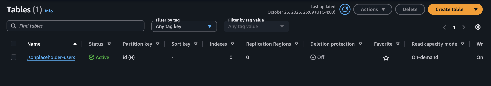

**2. Private S3 bucket created.** `lambda-backups-saf` is the destination for all backups (empty at this point).

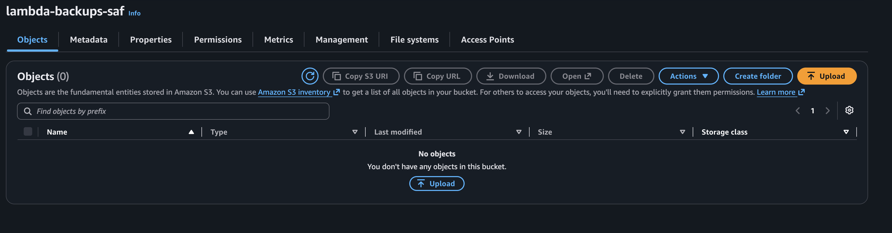

### Part B: Lambda #1, importing users into DynamoDB

**3. Writing the inline IAM policy.** This grants Lambda #1 `dynamodb:PutItem` on the table.

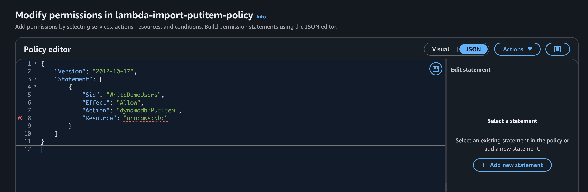

**4. Lambda #1 execution role.** The role has `AWSLambdaBasicExecutionRole` (logging) and the custom `lambda-import-putitem-policy` attached.

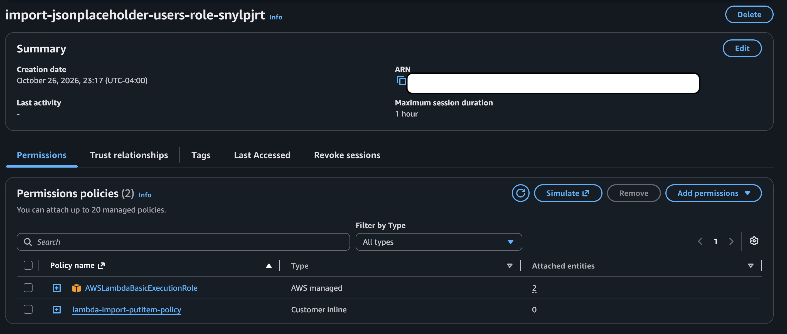

**5. Environment variable configured.** `TABLE_NAME` is set on Lambda #1.

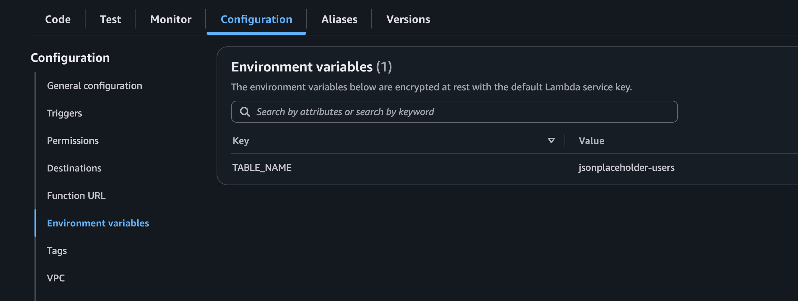

**6. Successful test run.** Lambda #1 returned `statusCode: 200` with `saved_count: 10`.

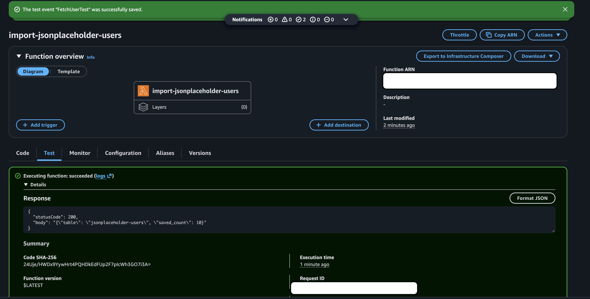

**7. Execution log output.** The log shows the API fetch and each `Saved user N: <name>` line (≈927 ms, 91 MB used).

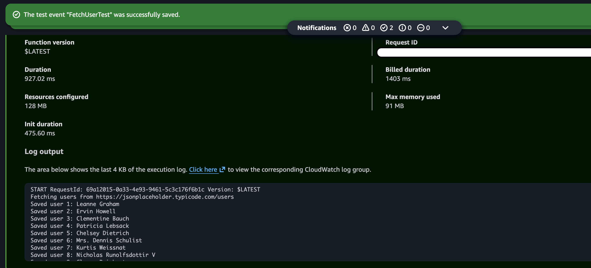

**8. CloudWatch Logs for Lambda #1.** The log stream under `/aws/lambda/import-jsonplaceholder-users`.

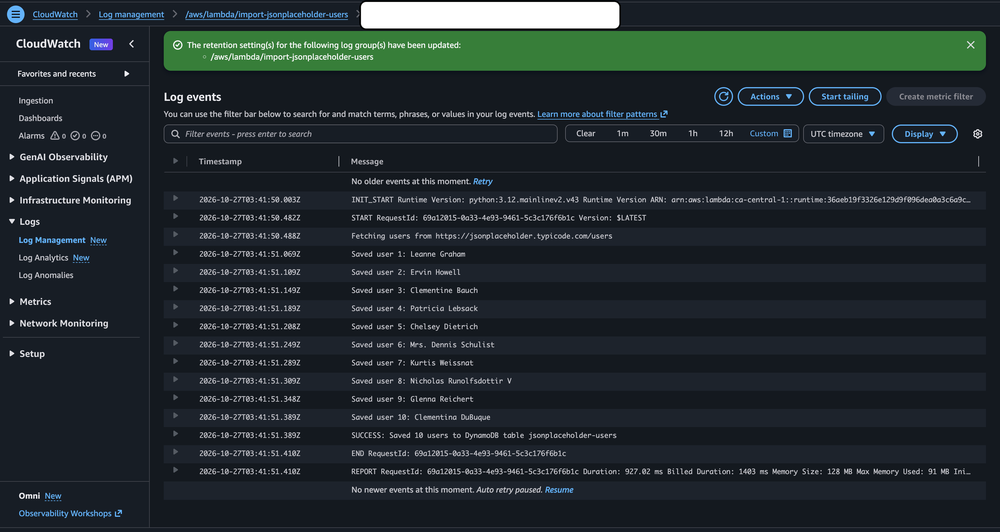

**9. Data in DynamoDB.** A table scan returns all **10 users** with nested `address` and `company` attributes.

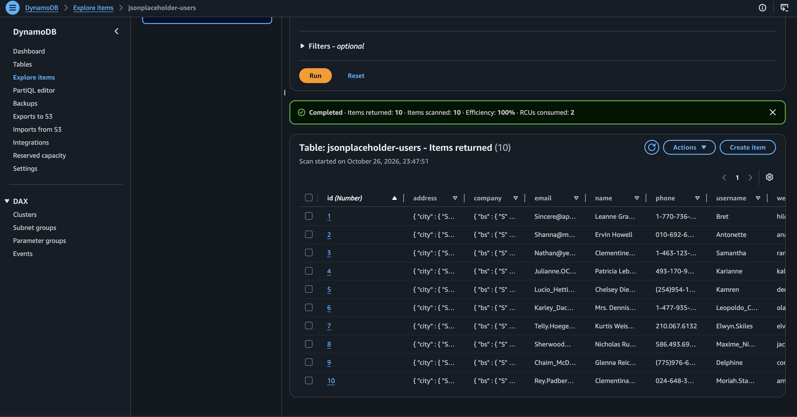

### Part C: Lambda #2, exporting DynamoDB to S3

**10. Lambda #2 created.** The `export-dynamodb-to-s3` function.

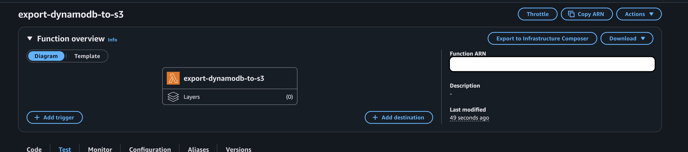

**11. Lambda #2 IAM policy.** `dynamodb:Scan` on the table plus `s3:PutObject` on the backup bucket.

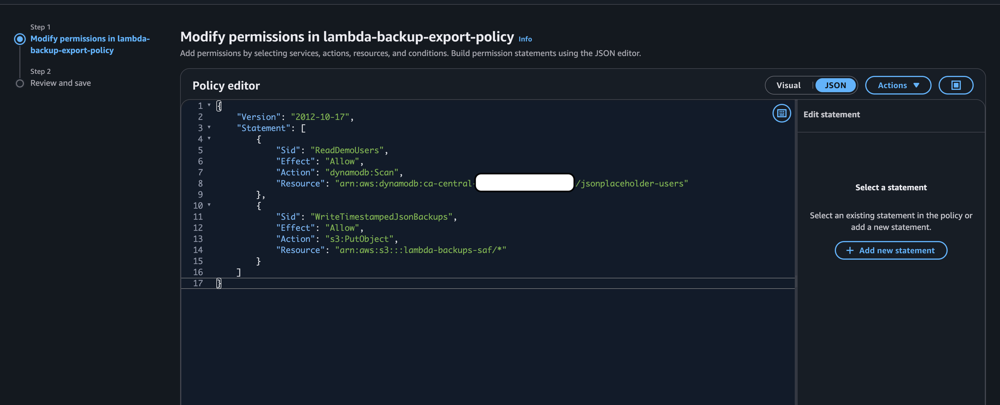

**12. Environment variables for Lambda #2.** `TABLE_NAME`, `BACKUP_PREFIX`, and `BUCKET_NAME`.

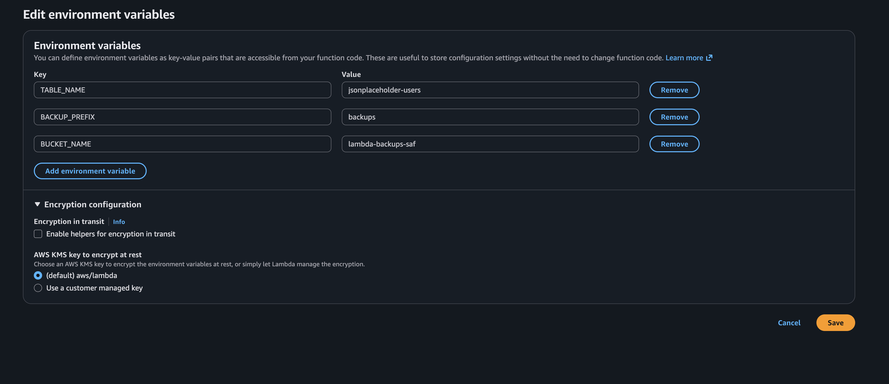

**13. Successful manual test.** It exported 10 users in 1 scan page to `s3://lambda-backups-saf/backups/2026-10-27/...json`.

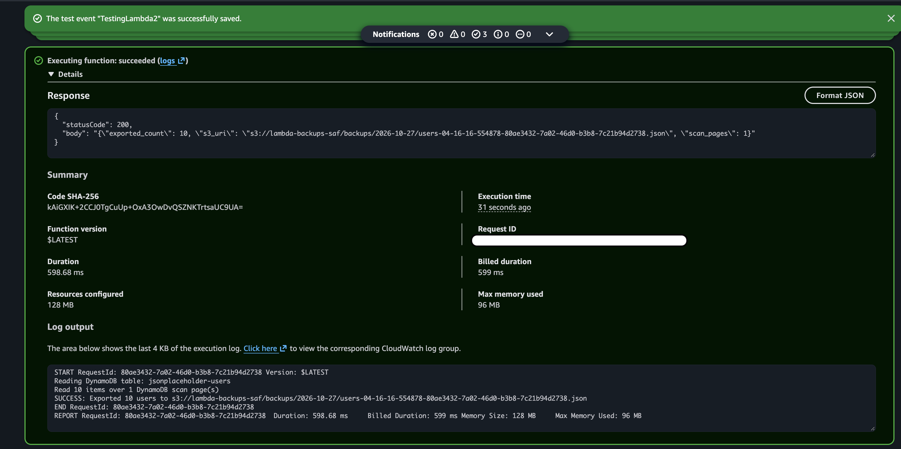

**14. First backup in S3.** A timestamped `users-...json` file (5.5 KB) appeared under `backups/2026-10-27/`.

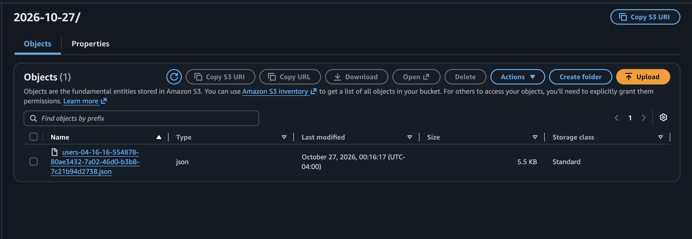

**15. CloudWatch log groups for both functions.** `/aws/lambda/export-dynamodb-to-s3` and `/aws/lambda/import-jsonplaceholder-users`.

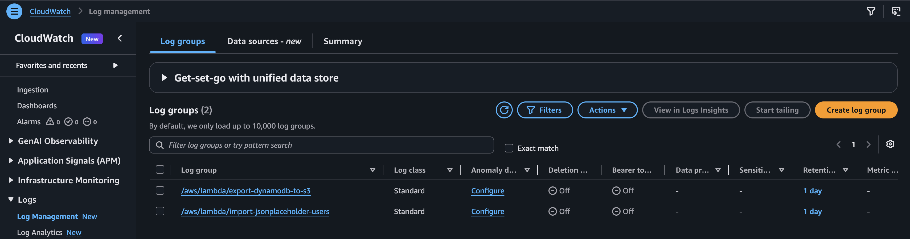

### Part D: Automation

**16. EventBridge schedule enabled.** `dynamodb-backup-every-2min` targets `export-dynamodb-to-s3` (`LAMBDA_Invoke`).

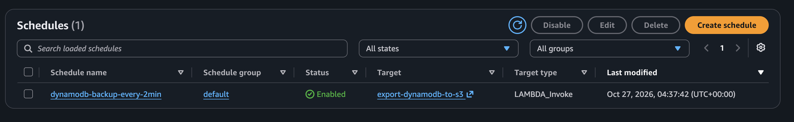

**17. Automated backups every 2 minutes.** New JSON files keep appearing at roughly 2-minute intervals (00:38, 00:40, 00:42), each with a unique key.

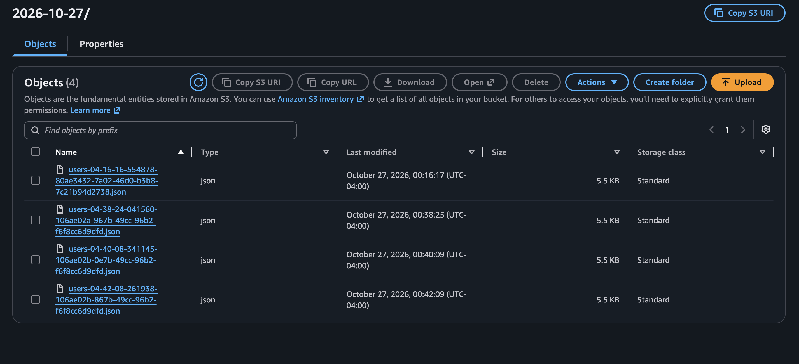

---

## Key Concepts & Lessons Learned

**Why does running Lambda #1 twice not produce 20 users?**
`PutItem` is an upsert on the partition key. A user with the same `id` replaces the existing item instead of adding a new one, so running the import again is idempotent.

**Lambda execution role vs. Scheduler execution role**
The *Lambda execution role* controls what the function's code can do (Scan, PutObject, write logs). The *Scheduler execution role* controls what EventBridge Scheduler can do, which here is only invoking the Lambda function. They are separate identities with separate trust policies.

**Why unique timestamps and request IDs in the S3 key?**
They guarantee that every run writes a new object. Old backups are never overwritten, and two invocations in the same second still get different keys.

**Logs vs. metrics**
`print()` output goes to **CloudWatch Logs**, which hold detailed application messages such as `Saved user 1: Leanne Graham`. **Metrics** such as `Invocations`, `Errors`, and `Duration` are collected automatically and track how often the function runs, how long it takes, and whether it failed.

**Could the table be restored from the JSON files alone?**
Only the item data. The JSON doesn't capture the key schema, indexes, capacity settings, TTL, streams, or access policies, so you would have to recreate the table configuration separately.

**Why is a 2-minute full-table export a poor production backup strategy?**
A `Scan` reads the entire table on every run, so it consumes read capacity and runs into Lambda's 15-minute and memory limits as the table grows. It is also **not a point-in-time snapshot**: items can change in the middle of a scan.

---

## Troubleshooting

| Symptom / error | Likely cause | Fix |
| --- | --- | --- |
| `KeyError: 'TABLE_NAME'` / `'BUCKET_NAME'` | Missing environment variable | Add it to the correct function |
| `AccessDeniedException` on `PutItem` / `Scan` | IAM policy missing or wrong ARN | Check the inline policy and table ARN |
| S3 `AccessDenied` | Bucket/prefix ARN mismatch | Make sure `s3:PutObject` covers `bucket/backups/*` |
| `ResourceNotFoundException` | Wrong table name or Region | Keep all resources in the same Region |
| `ValidationException` on primary key | `id` was created as a String | Recreate the table with `id` as **Number** |
| `Unable to import module 'lambda_function'` | Wrong ZIP or handler | Upload the function ZIP; handler is `lambda_function.lambda_handler` |
| Timeout calling the API | Lambda in a private VPC, or timeout too short | Don't attach a VPC; set the timeout to 30 s |
| Schedule enabled but no new files | Wrong target, bad Scheduler role, or Lambda error | Check the schedule target and Lambda #2 logs |

---

## Production Considerations

This project is a **JSON export pipeline**, not a full disaster-recovery solution. For a real workload, I would:

- Enable **DynamoDB Point-in-Time Recovery (PITR)** for continuous, consistent backups.
- Use the managed **DynamoDB Export to S3** feature, which doesn't consume table read capacity.
- Choose backup frequency and retention based on the workload's **RPO/RTO** targets.
- Define the infrastructure as code (AWS SAM, CDK, or Terraform) instead of clicking through the console.
- Package a pinned `boto3` version with each function.
- Add CloudWatch **alarms** on the Lambda `Errors` metric and a dead-letter queue for failed scheduled invocations.

**Cost note:** At a 2-minute rate, the scheduler creates ~30 files per hour, ~720 per day, and ~21,600 per month. Use the lifecycle rule above and disable the schedule when you don't need it.

---

## Cleanup

To avoid ongoing charges:

1. **Disable, then delete** the `dynamodb-backup-every-2min` schedule.
2. Delete both Lambda functions.
3. Delete the `jsonplaceholder-users` DynamoDB table.
4. Empty the S3 bucket (including any object versions), then delete it.
5. Delete the `/aws/lambda/...` CloudWatch log groups.
6. Remove the project's IAM execution roles and inline policies.

---

## References

- [AWS Lambda: Python ZIP deployment](https://docs.aws.amazon.com/lambda/latest/dg/python-package.html)
- [AWS Lambda: Python handler](https://docs.aws.amazon.com/lambda/latest/dg/python-handler.html)
- [Invoke Lambda with EventBridge Scheduler](https://docs.aws.amazon.com/lambda/latest/dg/with-eventbridge-scheduler.html)
- [EventBridge Scheduler: Getting started](https://docs.aws.amazon.com/scheduler/latest/UserGuide/getting-started.html)
- [Boto3 DynamoDB `Table.scan`](https://boto3.amazonaws.com/v1/documentation/api/latest/reference/services/dynamodb/table/scan.html)
- [Lambda execution role](https://docs.aws.amazon.com/lambda/latest/dg/lambda-intro-execution-role.html)

---

### Acknowledgements

This project began as a hands-on assignment from my mentor at **BongoDev**. I built, deployed, tested, and documented it in my own AWS account.
